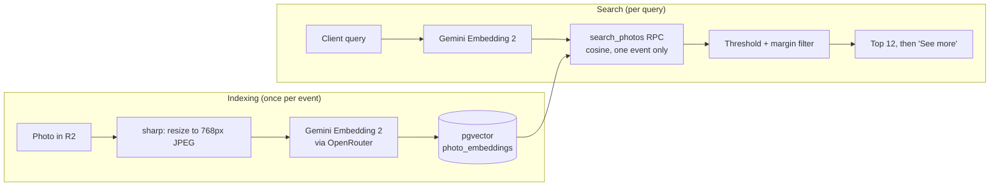

# Picselectr

A photo selection tool for photographers, with AI search. Clients get a private, PIN-protected link to their event photos and pick which ones they want delivered (digital files, album prints and album cover), while the photographer manages everything from a dashboard. Clients can also type what they're looking for ("la novia con su papá", _the bride with her dad_) and find those photos among hundreds or thousands.

Built solo and used by photography studios with real clients, starting with [Sttoria](https://sttoria.studio). I did everything end to end: product, schema, auth, storage, image processing, email, and the AI search with its evaluation.

Client pages are in Spanish or English, set per event. The studios' clients use Spanish, so Spanish text in this README is followed by its English translation in italics.

**[Live demo](#live-demo) · [Screenshots](#screenshots) · [AI search](#ai-photo-search) · [How I evaluated it](#how-i-evaluated-search)**

## Live demo

**[sttoria.studio/select/v0m5hd](https://sttoria.studio/select/v0m5hd)**, PIN **2781**

A demo wedding with 181 stock photos (no client photos), in English. Try searching:

- `wedding rings`, `the wedding cake`, `the couple kissing`, `the bride getting ready`
- `black and white photos`, `sunset`: style and light, not just objects
- `a vintage car`, `an Indian wedding`: one right photo among 181
- `a dog at the wedding`: the event has exactly three dog photos, and search returns those three

Selections you make there are saved, so other visitors may see them.

## Screenshots


|                   Admin dashboard                   |                  Client selection view                   |
| :-------------------------------------------------: | :------------------------------------------------------: |
|  |  |

## Why this project

Photographers coordinate photo selections over WhatsApp, email threads or shared folders. It's slow, error-prone, and there's no way to enforce package limits ("choose 300 digital photos, 150 of them for the album, and 2 for the cover"). Picselectr replaces that with one link, enforced limits per tier, and an email to the photographer the moment the client finishes.

Events range from a few hundred photos to about 4,000, and clients choose hundreds of them. Scrolling through 4,000 photos to find the five with your grandparents is the slowest part of choosing, which is what the AI search is for.

## Features

### For clients

- **Private selection link**: each event gets a `/select/[slug]` URL protected by a PIN, checked on the server
- **Three-tier selection** with limits per event: Digital → Album → Cover, each a subset of the last
- **Cascading rules**: removing a digital photo also removes it from the album and cover
- **AI photo search**: describe a photo in your own words and get the best matches first
- **Autosave** and a full-screen preview with selection controls
- **Mobile-first grid**, since most clients choose from their phone

### For photographers (`/events`)

- **Event management** for weddings, quinceañeras, birthdays, photo sessions and custom types
- **Photo uploads** with automatic thumbnails, and AI search indexing switched on per event
- **Live selection review**: see what a client picked, per tier, as they pick it
- **Completion email** listing every photo chosen per tier
- **Delivery galleries**: a separate PIN-protected page to deliver the final photos

## AI photo search

Each photo is turned into an embedding (a vector of 768 numbers that captures what's in it) by a multimodal model. A client's query is embedded by the same model, and search returns the photos whose vectors are closest to it.



### Design decisions

| Decision                                                                                                                           | Why                                                                                                                                                                                                                                                                         |
| ---------------------------------------------------------------------------------------------------------------------------------- | --------------------------------------------------------------------------------------------------------------------------------------------------------------------------------------------------------------------------------------------------------------------------- |
| **Indexing in resumable batches**: 50 photos per call, 25 images per provider request, a 45 s work budget and a 55 s hard deadline | Vercel Hobby functions stop at 60 s. Each call stores what it finished; the browser calls again until `remaining` is 0. Inserts are idempotent, so an interrupted run resumes without duplicates.                                                                           |
| **Waiting out rate limits in the browser**                                                                                         | The provider's per-minute quota returns 429s or holds requests until they time out. The server reports `provider_busy` instead of sleeping (server time is limited and billed); the browser waits 30 s, which is free, and gives up after about 3 minutes without progress. |
| **Exact search within one event** instead of the HNSW index                                                                        | Every query is scoped to one event (a few hundred to ~4,000 photos). An HNSW scan followed by a filter can return too few rows, while an exact scan over one event's vectors is fast and always complete. The HNSW index is kept for future cross-event features.           |
| **Model and dimension stored on every row** (`google/gemini-embedding-2@768`)                                                      | Vectors are only comparable within one model, dimension and input type. Tagging rows lets a future model be indexed alongside the current one and switched over without a migration.                                                                                        |
| **Separate input types**: `search_document` for photos, `search_query` for text                                                    | The model encodes the two differently. Mixing them up measurably changes the vectors.                                                                                                                                                                                       |
| **Two filters on the results**: a fixed threshold (0.57) and a margin below the best match (0.06)                                  | The threshold keeps unrelated queries empty. The margin trims photos that only share the event's theme. Both were set from the evaluation below.                                                                                                                            |
| **Show 12 results, then "See more"**                                                                                               | Scores flatten out after the first dozen. See below.                                                                                                                                                                                                                        |
| **No training or retention by the provider** (`data_collection: "deny"`)                                                           | These are clients' personal photos. Images are also downscaled to 768 px before they leave the server.                                                                                                                                                                      |

## How I evaluated search

Choosing the thresholds by eye didn't work, so I built [`scripts/eval-search.mjs`](scripts/eval-search.mjs). It runs hand-labeled queries against a real indexed event through the same RPC the app uses, and reports:

- **recall@K**: of the photos that should appear, how many are in the first K results;
- **precision**: of the photos shown, how many are right;
- whether **negative queries** (things that aren't in the event, like "un carro de carrera", _a race car_) correctly return nothing;
- a sweep over thresholds and margins, plus, for each query, the shown photos that aren't labeled, to make labeling faster.

**Test set:** a 122-photo wedding with 9 labeled queries (people, moments, objects, places) and 5 negative queries.

**What the data changed:**

1. **The threshold.** My first guess, 0.6, came from synthetic test images. On real photos, short queries like "anillos" (_rings_) scored their correct matches at 0.57–0.59, while the highest unrelated query reached 0.551. I lowered it to **0.57**, which kept every negative query empty and raised recall from 79% to 84.5%.
2. **A relative margin.** On a wedding, every photo scores around 0.60 against any wedding query, so a fixed threshold let the whole event through. Searching "la novia maquillándose" (_the bride doing her makeup_) returned groom and ceremony photos after the right ones. Dropping results more than **0.06** below the best match fixed that case: 25 results became 11.
3. **A cap of 12 results.** For "novio con los padres" (_the groom with his parents_), all 48 results fell within 0.045 of each other: right order, almost no separation. No filter could separate them without hurting other queries, so the page shows the top 12 first and the rest behind a "Ver más resultados" (_see more results_) button.

| Results shown first | Recall    | Precision |
| ------------------- | --------- | --------- |
| 8                   | 77.8%     | 76.4%     |
| **12 (shipped)**    | **80.2%** | **75.0%** |
| 20                  | 84.5%     | 67.8%     |

Negative queries: **5 of 5** return nothing.

**Second test set: the English demo.** The [live demo](#live-demo)'s 181 stock photos, with 13 labeled queries and 5 negatives in [`scripts/eval/demo.json`](scripts/eval/demo.json), so anyone can reproduce these numbers. With the same settings:

| Event                  | Photos | Recall | Precision | Negatives empty |
| ---------------------- | ------ | ------ | --------- | --------------- |
| Real wedding (Spanish) | 122    | 80.2%  | 75.0%     | 5 of 5          |
| Demo wedding (English) | 181    | 85.9%  | 62.7%     | 2 of 5          |

The three negatives that leak show one or two photos each, and they're near misses: "a race car" finds the vintage car, and "a person reading on a train" finds rings resting on an open book. A threshold of 0.60 would empty all five on this event but lose recall on the real one, where correct matches score as low as 0.57. Running the same English queries on the Spanish event gave lower scores, so the difference comes from the photos, not the language. I kept one setting for both.

**Checking the index.** When results looked off, I re-embedded sample photos exactly as the indexer does and compared them with the stored vectors. Every one matched its own photo with cosine similarity 1.0000, so the problem was the model's score distribution, not the pipeline.

**Known limitations.** Queries about a setting or a vague group ("los invitados", _the guests_: 28% precision) are the weakest; queries about people and what they're doing are the strongest. Every photo also carries the studio's watermark, which the model reads as shared content; its effect hasn't been measured yet.

```bash
node --env-file=.env.local scripts/eval-search.mjs scripts/eval/your-event.json
```

The ground-truth format is in [`scripts/eval/ground-truth.example.json`](scripts/eval/ground-truth.example.json).

## Cost and operations

|                              | Cost                        |
| ---------------------------- | --------------------------- |
| Indexing one photo           | ~$0.0001 (about 258 tokens) |
| Indexing a 4,000-photo event | ~$0.46                      |
| One search                   | ~$0.000003                  |

- Every provider call is logged to an `ai_usage` table (operation, tokens, cost, model) per event.
- Search has a daily cap per event for clients, 200 queries, counted from that log; the photographer is exempt.
- Provider timeouts and 429s are handled as "busy" rather than as failures, and every request has a deadline that keeps the serverless function under its time limit.

## Security

The app holds clients' personal photos for several studios, so access is enforced on the server:

- **Studios only see their own data.** Postgres row-level security scopes events and photos to the account that created them.
- **The PIN is checked on the server.** Without a valid access cookie, `/select` and `/gallery` send only the PIN form, with no photo URLs or selection data. The cookie is an `httpOnly` HMAC of the event and its PIN, so it can't be forged, and it stops working if the photographer changes the PIN.
- **PIN guessing is rate-limited on the server**: 5 wrong tries per visitor per event, then a 15-minute wait, plus a ceiling per event across all visitors. IPs are stored hashed.
- **Server actions check access themselves.** Saving or submitting a selection requires the owner's session or the access cookie, since a server action can be called by anyone who has the page.
- **Endpoints that cost money** (search, indexing) require the same access, and indexing requires the event's owner.

## Architecture

```
Client (phone)                    Photographer
      │                                │
      ▼                                ▼
┌────────────────────────────────────────────────┐
│                Next.js App Router               │
│  /select/[slug], /gallery/[slug]   /events/*    │
│  (PIN checked on the server)       (signed in)  │
│  /api/events/[slug]/search, /index              │
└──────┬──────────────────┬──────────────┬────────┘
       │                  │              │
┌──────▼──────────┐ ┌─────▼────────┐ ┌───▼──────────────┐
│ Supabase        │ │ Cloudflare R2│ │ OpenRouter       │
│ Postgres + RLS  │ │ originals +  │ │ Gemini Embedding │
│ pgvector, Auth  │ │ thumbnails   │ │ 2 (multimodal)   │
└──────┬──────────┘ └──────────────┘ └──────────────────┘
       │
┌──────▼──────────┐
│ Resend (email   │
│ on completion)  │
└─────────────────┘
```

- **Auth and session refresh** run in [`proxy.ts`](proxy.ts) with Supabase SSR cookies, so `/events/*` is protected on the server with no client-side flicker.
- **Storage**: originals and thumbnails are generated with `sharp` on upload ([`app/api/upload/route.ts`](app/api/upload/route.ts)) and sent to Cloudflare R2 through the S3-compatible SDK.
- **Search**: indexing in [`app/api/events/[slug]/index/route.ts`](app/api/events/%5Bslug%5D/index/route.ts), queries in [`app/api/events/[slug]/search/route.ts`](app/api/events/%5Bslug%5D/search/route.ts), the provider client in [`lib/embeddings.ts`](lib/embeddings.ts), and the SQL in [`supabase/migrations`](supabase/migrations).
- **Email**: completion emails are fire-and-forget, so a failed send never blocks a client's save.

## Tech stack

| Layer            | Choice                                                         |
| ---------------- | -------------------------------------------------------------- |
| Framework        | [Next.js 16](https://nextjs.org/) (App Router, Server Actions) |
| Language         | TypeScript                                                     |
| UI               | React 19, Tailwind CSS v4                                      |
| Database / auth  | Supabase (Postgres, row-level security, Auth)                  |
| Vector search    | pgvector                                                       |
| Embeddings       | Gemini Embedding 2 via OpenRouter (multimodal, 768 dimensions) |
| File storage     | Cloudflare R2 (S3-compatible, `@aws-sdk/client-s3`)            |
| Image processing | `sharp`                                                        |
| Email            | Resend                                                         |
| Hosting          | Vercel                                                         |

## Getting started

```bash
pnpm install
cp .env.example .env.local   # fill in your credentials
pnpm dev
```

The SQL in [`supabase/migrations`](supabase/migrations) is applied in filename order. The base tables (`events`, `photos`, `selections`) predate the migrations folder and aren't in it yet.

<!-- TODO: add a baseline migration from `supabase db dump --schema-only` so a fresh project can be set up from this repo -->

### Environment variables

| Variable                                                                                                                                     | Purpose                                                         |
| -------------------------------------------------------------------------------------------------------------------------------------------- | --------------------------------------------------------------- |
| `NEXT_PUBLIC_SUPABASE_URL` / `NEXT_PUBLIC_SUPABASE_ANON_KEY`                                                                                 | Supabase project connection                                     |
| `SUPABASE_SERVICE_ROLE_KEY`                                                                                                                  | Server-side privileged access (uploads, public pages, indexing) |
| `CLOUDFLARE_R2_ENDPOINT` / `CLOUDFLARE_R2_ACCESS_KEY_ID` / `CLOUDFLARE_R2_SECRET_ACCESS_KEY` / `CLOUDFLARE_R2_BUCKET_NAME` / `R2_PUBLIC_URL` | Photo storage                                                   |
| `OPENROUTER_API_KEY`                                                                                                                         | Embeddings for AI search                                        |
| `GALLERY_ACCESS_SECRET`                                                                                                                      | Signs the PIN access cookies                                    |
| `RESEND_API_KEY` / `RESEND_FROM_EMAIL`                                                                                                       | Completion emails (optional; skipped if unset)                  |

```bash
pnpm lint     # ESLint
pnpm build    # Production build
```

## Roadmap

- [ ] Automated tests (unit + e2e)
- [ ] Measure the watermark's effect on search, using clean copies of the same event
- [ ] Improve setting and group queries ("en la iglesia", _at the church_; "los invitados", _the guests_), e.g. with generated photo descriptions
- [ ] Bulk photo download for photographers
- [x] Client selection pages in Spanish or English, set per event
- [ ] Translate the delivery gallery and the photographer dashboard

## Credits

The demo event's photos are from [Pixabay](https://pixabay.com), used under the [Pixabay Content License](https://pixabay.com/service/license-summary/). Each photo's author and source are listed in [`docs/demo-photo-credits.md`](docs/demo-photo-credits.md). They were downloaded with [`scripts/fetch-demo-photos.mjs`](scripts/fetch-demo-photos.mjs).

## About

Built by [Ernesto Aviles](https://github.com/Eavilesz). Feel free to reach out at ernesto-av@hotmail.com.
